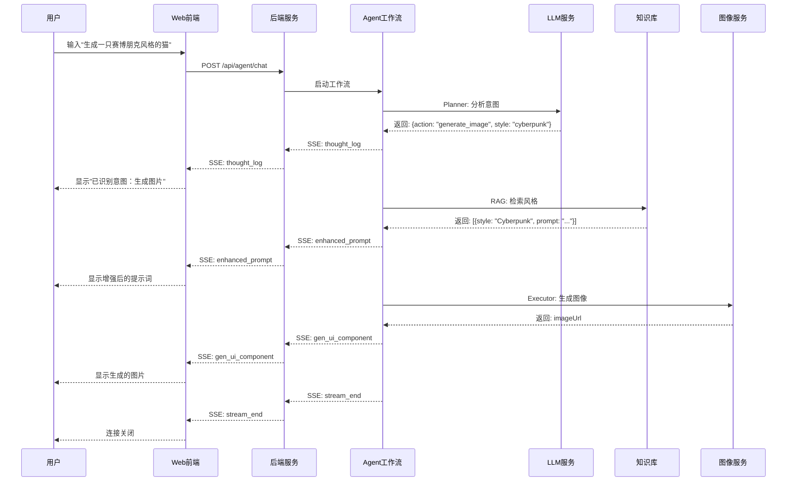
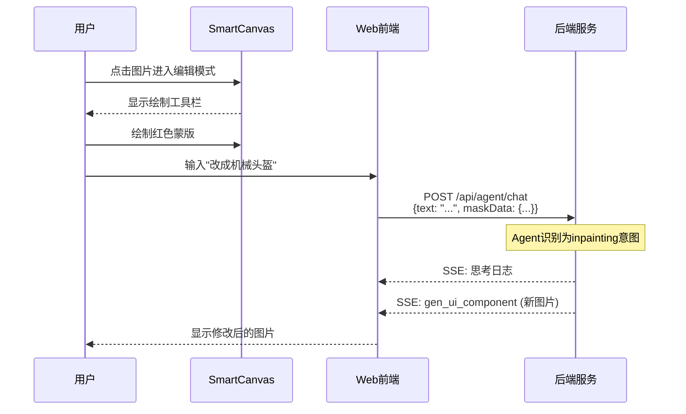

# AiVista 产品文档

## 目录

1. [产品概述](#产品概述)
2. [核心功能](#核心功能)
3. [技术架构](#技术架构)
4. [系统组成](#系统组成)
5. [用户交互流程](#用户交互流程)
6. [实施总结](#实施总结)

---

## 产品概述

### 1.1 产品定位

AiVista 是一个基于 AI 的多平台智能图像生成与编辑应用，灵感来源于"即梦 AI"等 AI 绘画工具。产品通过 Agent 智能体系统，为用户提供文生图、局部重绘、参数调整等功能，实现了从文本创意到图像生成的完整工作流。

### 1.2 核心价值

- **智能化交互**：用户只需用自然语言描述创意，AI Agent 自动识别意图并执行相应操作
- **多模态支持**：支持文本输入、图像编辑（蒙版绘制）、参数调整等多种交互方式
- **实时反馈**：通过 SSE 流式通信，实时展示 Agent 思考过程和生成进度
- **可扩展性**：基于 LangGraph 的工作流编排，支持灵活的功能扩展和模型切换

### 1.3 应用场景

- **创意设计**：设计师快速生成创意原型和风格参考
- **内容创作**：自媒体创作者生成配图和素材
- **教育学习**：艺术学习和风格探索
- **娱乐体验**：普通用户体验 AI 绘画的乐趣

---

## 核心功能

### 2.1 文生图 (Text-to-Image)

**功能描述**：用户输入文本描述，系统生成对应图像。

**交互流程**：
1. 用户输入："生成一只赛博朋克风格的猫"
2. Agent 识别意图 → 检索风格库 → 生成图像
3. 实时展示思考过程和生成结果

**技术要点**：
- LLM 意图识别（支持多模型切换）
- RAG 风格检索增强
- 支持指定图片生成模型（qwen-image/qwen-image-max/qwen-image-plus/z-image-turbo）

### 2.2 局部重绘 (Inpainting)

**功能描述**：用户在图像上绘制蒙版区域，通过文本描述修改该区域内容。

**交互流程**：
1. 用户点击图像进入编辑模式
2. 使用画笔涂抹需要修改的区域
3. 输入修改指令："把这里改成机械头盔"
4. Agent 执行局部重绘并返回新图像

**技术要点**：
- 前端 Canvas 蒙版绘制
- Base64 图像数据传输
- 支持 URL 引用和本地图像

### 2.3 参数调整 (Parameter Adjustment)

**功能描述**：用户通过滑块等 UI 组件调整生成参数，实时重新生成。

**交互流程**：
1. Agent 根据当前状态推荐参数调整组件
2. 前端渲染 GenUI 组件（如滑块）
3. 用户拖动滑块触发重新生成

**技术要点**：
- GenUI 动态组件系统
- 后端下发 UI 配置，前端动态渲染
- 支持参数保存和快速切换

### 2.4 多轮对话

**功能描述**：支持连续对话，保持上下文，支持提示词续写和修改。

**交互流程**：
1. 首轮生成："生成一只猫"
2. 续写生成："加上墨镜"
3. 修改指令："背景改成星空"

**技术要点**：
- 会话状态管理（sessionId）
- 历史消息维护（最多 50 条）
- 提示词合并和优化

### 2.5 知识库管理

**功能描述**：管理风格知识库，支持增删改查和向量检索。

**功能特性**：
- 预置 5 种风格（赛博朋克、水彩、极简、动漫、印象派）
- 支持自定义风格添加
- 向量语义检索
- 风格相似度匹配

---

## 技术架构

### 3.1 整体架构

AiVista 采用前后端分离架构，包含三个核心模块：

```
┌─────────────────────────────────────────────────────────┐
│                      用户层                              │
│  ┌──────────────┐  ┌──────────────┐  ┌──────────────┐  │
│  │  Web 前端    │  │  移动端 App  │  │  未来扩展    │  │
│  │  (Next.js)   │  │  (Flutter)   │  │              │  │
│  └──────────────┘  └──────────────┘  └──────────────┘  │
└─────────────────────────────────────────────────────────┘
                          ↕ SSE / HTTP
┌─────────────────────────────────────────────────────────┐
│                   后端服务层                              │
│  ┌──────────────────────────────────────────────────┐   │
│  │           NestJS Server + LangGraph              │   │
│  │  ┌─────────┐ ┌─────────┐ ┌─────────┐ ┌────────┐ │   │
│  │  │ Planner │ │   RAG   │ │Executor │ │ Critic │ │   │
│  │  └─────────┘ └─────────┘ └─────────┘ └────────┘ │   │
│  └──────────────────────────────────────────────────┘   │
│  ┌──────────────┐  ┌──────────────┐  ┌─────────────┐  │
│  │ LLM 服务     │  │ 图像服务     │  │ 向量数据库  │  │
│  │ (多模型适配) │  │ (阿里云/Mock)│  │ (LanceDB)   │  │
│  └──────────────┘  └──────────────┘  └─────────────┘  │
└─────────────────────────────────────────────────────────┘
                          ↕
┌─────────────────────────────────────────────────────────┐
│                   外部服务层                              │
│  ┌──────────────┐  ┌──────────────┐  ┌──────────────┐  │
│  │ 阿里云通义   │  │  DeepSeek    │  │  OpenAI      │  │
│  │ (千问/图像)  │  │  (推理)      │  │  (可选)      │  │
│  └──────────────┘  └──────────────┘  └──────────────┘  │
└─────────────────────────────────────────────────────────┘
```

### 3.2 后端技术栈

| 技术 | 版本 | 用途 |
|------|------|------|
| Node.js | 18+ | 运行时环境 |
| NestJS | 10.x | 后端框架 |
| LangGraph | Latest | Agent 工作流编排 |
| LangChain | Latest | LLM 应用框架 |
| LanceDB | Latest | 向量数据库 |
| TypeScript | 5.x | 开发语言 |

**核心依赖**：
- `@langchain/core`：LangChain 核心库
- `@langchain/community`：社区集成（阿里云通义千问）
- `@langchain/openai`：OpenAI 适配（DeepSeek 兼容）
- `@nestjs/common`：NestJS 核心模块
- `lancedb`：向量数据库客户端

### 3.3 前端技术栈

| 技术 | 版本 | 用途 |
|------|------|------|
| React | 18+ | UI 框架 |
| Next.js | 14+ | 全栈框架 |
| TypeScript | 5.x | 开发语言 |
| TailwindCSS | Latest | 样式框架 |
| shadcn/ui | Latest | UI 组件库 |
| Zustand | Latest | 状态管理 |

### 3.4 移动端技术栈

| 技术 | 版本 | 用途 |
|------|------|------|
| Flutter | 3.x | 跨平台框架 |
| FVM | 3.38.5 | 版本管理 |
| Provider | Latest | 状态管理 |

---

## 系统组成

### 4.1 后端服务 (main/server)

#### 目录结构

```
server/
├── src/
│   ├── agent/              # Agent 工作流模块
│   │   ├── nodes/          # LangGraph 节点实现
│   │   │   ├── planner.node.ts
│   │   │   ├── rag.node.ts
│   │   │   ├── executor.node.ts
│   │   │   └── critic.node.ts
│   │   ├── agent.service.ts
│   │   ├── agent.controller.ts
│   │   └── agent.module.ts
│   ├── llm/                # LLM 服务适配层
│   │   ├── interfaces/
│   │   ├── services/
│   │   │   ├── aliyun-llm.service.ts
│   │   │   └── llm-provider-factory.service.ts
│   │   └── llm.module.ts
│   ├── knowledge/          # 知识库服务
│   │   ├── knowledge.service.ts
│   │   ├── knowledge.controller.ts
│   │   └── knowledge.module.ts
│   ├── image/              # 图像服务
│   │   ├── interfaces/
│   │   ├── services/
│   │   │   ├── aliyun-image.service.ts
│   │   │   └── mock-image.service.ts
│   │   └── image.module.ts
│   └── main.ts
├── docs/                   # 服务端文档
└── package.json
```

#### 核心模块说明

**1. Agent 工作流模块**

负责编排整个 AI 工作流，包含四个核心节点：

- **Planner Node**：意图识别节点
  - 调用 LLM 分析用户输入
  - 提取关键信息（主体、风格、动作）
  - 输出结构化意图对象

- **RAG Node**：检索增强节点
  - 使用 LanceDB 进行向量检索
  - 查找相关风格提示词
  - 合并原始 prompt 和检索结果

- **Executor Node**：执行节点
  - 根据意图执行具体任务
  - 调用图像生成服务
  - 处理蒙版数据（局部重绘）

- **Critic Node**：审查节点（可选）
  - 评估生成结果质量
  - 决定是否需要重试
  - 最多重试 3 次

**2. LLM 服务适配层**

支持多模型切换的统一接口：

- **接口定义**：`ILlmService`
- **实现类**：
  - `AliyunLlmService`：阿里云通义千问
  - `DeepSeekLlmService`：DeepSeek（兼容 OpenAI 协议）
- **工厂模式**：`LlmProviderFactory` 根据配置动态创建实例

**3. 知识库服务**

基于 LanceDB 的向量数据库：

- 预置 5 种风格数据
- 支持增删改查操作
- 向量语义检索
- 相似度评分

**4. 图像服务**

支持多种图像生成源：

- `AliyunImageService`：阿里云通义万相
- `MockImageService`：模拟生成（开发测试用）
- 接口统一：`IImageService`

### 4.2 Web 前端 (main/web)

#### 目录结构

```
web/
├── app/                    # Next.js App Router
│   ├── (main)/            # 主应用分组
│   │   ├── page.tsx       # 首页
│   │   └── knowledge/     # 知识库管理页面
│   ├── chat/              # AI 智绘页面
│   └── layout.tsx
├── components/
│   ├── chat/              # 聊天相关组件
│   │   ├── chat-interface.tsx
│   │   ├── message-list.tsx
│   │   ├── input-area.tsx
│   │   └── thought-log.tsx
│   ├── genui/             # GenUI 组件系统
│   │   ├── smart-canvas.tsx
│   │   ├── agent-message.tsx
│   │   ├── image-view.tsx
│   │   └── renderer.tsx
│   ├── knowledge/         # 知识库组件
│   ├── layout/            # 布局组件
│   └── ui/                # shadcn/ui 组件
├── lib/
│   ├── api/               # API 客户端
│   ├── sse/               # SSE 客户端
│   └── utils/             # 工具函数
├── stores/                # Zustand 状态管理
└── docs/                  # 前端文档
```

#### 核心模块说明

**1. GenUI 组件系统**

动态组件渲染系统，支持后端下发 UI 配置：

- **SmartCanvas**：智能画布
  - 图像展示
  - 蒙版绘制（红色画笔）
  - 撤销/重做
  - 下载功能

- **AgentMessage**：Agent 消息气泡
  - 思考状态展示
  - 成功/失败状态

- **ImageView**：图片展示组件
  - 自适应尺寸
  - 加载状态

**2. SSE 客户端**

实时通信管理：

- `SSEClient`：连接管理类
  - 自动重连（指数退避）
  - 事件分发
  - 错误处理

- `useSSE` Hook：React Hook 封装

**3. 状态管理**

使用 Zustand 管理全局状态：

- `sessionStore`：会话状态
- `uiStore`：UI 状态
- `chatStore`：聊天状态

### 4.3 移动端 (main/client)

基于 Flutter 的移动应用（待完善）：

- iOS / Android 双平台支持
- Provider 状态管理
- HTTP/SSE 通信

---

## 用户交互流程

### 5.1 文生图完整流程



### 5.2 局部重绘流程



### 5.3 多轮对话流程

1. **首轮生成**：
   - 用户："生成一只猫"
   - 生成图片 → 显示在 SmartCanvas

2. **提示词续写**：
   - 用户："加上墨镜"
   - 系统合并 prompt："生成一只猫, 加上墨镜"
   - 重新生成 → 更新当前图片

3. **修改指令**：
   - 用户："背景改成星空"
   - 系统识别修改意图
   - 使用新 prompt 重新生成

**技术要点**：
- 使用 `sessionId` 保持会话上下文
- 维护 `previousPrompts` 历史记录
- SmartCanvas 自动更新当前图片

### 5.4 边界情况处理

| 场景 | 处理方式 |
|------|---------|
| 空输入 | 返回错误："请输入内容" |
| 意图未知 | 返回友好提示："抱歉，我不太理解您的意思" |
| 纯蒙版无文本 | 提示用户输入修改指令 |
| 网络断开 | SSE 自动重连（最多 5 次） |
| 生成失败 | 显示错误消息，保留历史记录 |
| 超时 | 60 秒超时，自动终止工作流 |

---

## 实施总结

### 6.1 技术亮点

**1. Agent 工作流编排**
- 使用 LangGraph 实现状态图模式
- 清晰的节点职责划分
- 支持流式执行和状态追踪
- 易于扩展和维护

**2. 多模型适配**
- 统一的 LLM 服务接口
- 支持阿里云、DeepSeek、OpenAI 等多种模型
- 配置化切换，无需修改代码
- 降低供应商锁定风险

**3. GenUI 动态组件系统**
- 后端下发 UI 配置，前端动态渲染
- 支持 append/replace/update 三种更新模式
- 类型安全的组件映射
- 灵活的交互响应

**4. 实时流式通信**
- SSE 长连接，服务端主动推送
- 展示 Agent 思考过程
- 提升用户体验和可感知性
- 自动重连和错误恢复

**5. 向量检索增强**
- LanceDB 本地向量数据库
- 语义相似度匹配
- 提升生成质量
- 支持自定义风格库

### 6.2 可扩展性

**水平扩展**：
- 无状态设计，支持多实例部署
- 会话状态可通过 Redis 共享
- LanceDB 支持分布式部署

**功能扩展**：
- 添加新的 Agent 节点（如 StyleTransferNode）
- 集成新的图像生成服务（Midjourney、Stability AI）
- 添加新的 GenUI 组件类型

**模型扩展**：
- 实现 `ILlmService` 接口即可接入新模型
- 实现 `IImageService` 接口即可接入新图像服务

### 6.3 性能优化

**后端优化**：
- 节点并行执行（RAG 可与其他操作并行）
- 结果缓存（相同 prompt 缓存 1 小时）
- 连接池管理
- 异步生成器减少内存占用

**前端优化**：
- 虚拟滚动（消息列表）
- 图片懒加载
- 代码分割和动态导入
- React.memo 避免不必要渲染

### 6.4 安全考虑

**输入验证**：
- 文本长度限制（1000 字符）
- Base64 大小限制（10MB）
- 参数类型校验

**数据安全**：
- API Key 环境变量管理
- HTTPS 通信
- 敏感信息不暴露给前端

**错误处理**：
- 统一错误响应格式
- 友好的错误提示
- 完整的日志记录

### 6.5 未来规划

**短期目标**：
- 完善移动端 Flutter 应用
- 添加用户认证系统
- 支持图像上传和本地存储
- 优化图像生成速度

**中期目标**：
- 支持更多图像编辑功能（超分辨率、风格迁移）
- 添加社交分享功能
- 实现付费订阅模式
- 支持批量生成

**长期愿景**：
- 构建开放平台，支持第三方插件
- AI 模型微调和定制
- 多语言国际化
- 企业级部署方案

---

## 相关文档

### 架构设计
- [系统架构](./architecture.md) - 详细的系统架构设计
- [Agent 状态机](./agent_state_machine.md) - Agent 工作流状态机
- [GenUI 协议](./gen_ui_protocol.md) - GenUI 组件协议规范

### 功能实现
- [会话与缓存](./01-会话与AI回复缓存.md) - 会话管理和缓存机制
- [GenUI 与对话 UI](./02-GenUI与对话UI.md) - GenUI 组件系统实现
- [侧边栏与会话项](./03-侧边栏与会话项.md) - 侧边栏和会话管理

### 设计文档
- [产品规格](./product_spec.md) - 产品功能规格说明
- [后端路线图](./backend_roadmap.md) - 后端开发路线图
- [决策矩阵](./decision_matrix.md) - 技术选型决策

### 技术细节
- [Canvas 坐标系统](./canvas_coordinate_system.md) - SmartCanvas 坐标系设计

### 实现文档
- [服务端实现文档](../main/server/docs/OVERVIEW.md) - 后端详细实现说明
- [前端实现文档](../main/web/docs/OVERVIEW.md) - 前端详细实现说明

---

**文档版本**：v1.0
**最后更新**：2025-02-01
